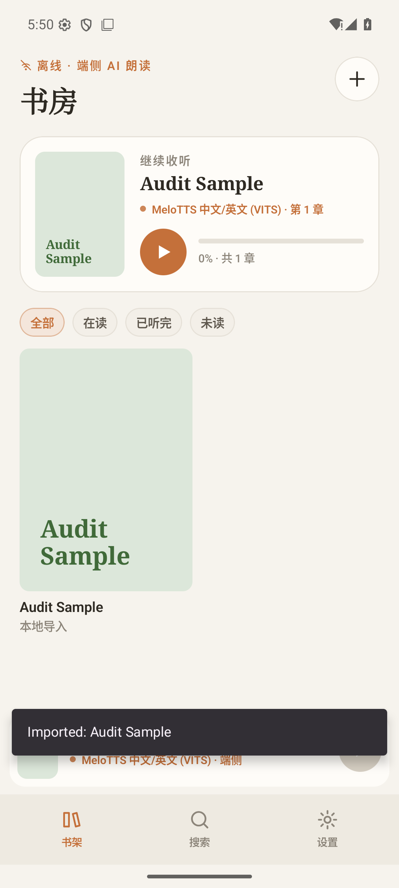
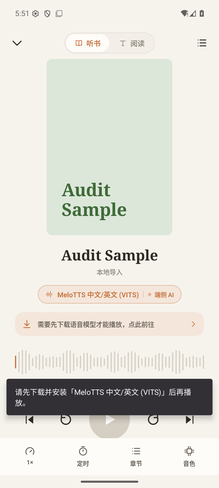
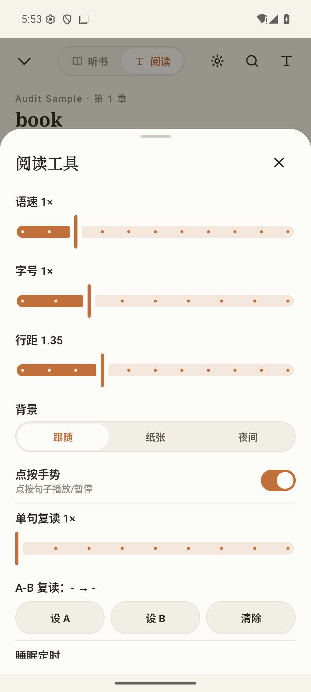

# AudioBooks 产品体验审计（v0.3.0）

审计日期：2026-08-09

审计环境：Pixel 8 模拟器、Android 36、全新安装、v0.3.0 Debug 构建

审计范围：首次启动 → 添加书籍 → 粘贴文本 → 首次播放 → 模型管理 → 设置 → 阅读 → 阅读工具

审计归档：`codex/audit` 分支

## 总体结论

产品已经具备成熟、统一的视觉语言，也准确抓住了“内容不出本机”的差异化价值；但首次价值闭环没有完成。用户连续看到“端侧 AI 将为你朗读”“开始生成并收听”“继续收听”，直到按下播放才得知还必须下载 166 MB 模型。这个落差会直接伤害信任和首日留存。

当前建议评分：

- 视觉与品牌一致性：8/10
- 信息架构：6/10
- 首次使用成功率：4/10
- 日常播放效率：6/10
- 可访问性：3/10
- 上线成熟度：不建议在修复 P0 问题前面向普通消费者发布

建议的核心成功标准：**新用户在不知道“模型、推理引擎、ONNX”等概念的情况下，能清楚预期下载成本，并成功听到第一句话。**

## 流程证据与健康度

### 1. 首次启动：空书房 — 健康

优点：价值主张、支持格式和主操作都很清楚；“内容不出本机”建立了信任。

风险：顶部纯图标“+”没有辅助功能名称；页面说“端侧 AI 将为你朗读”，却没有说明首次朗读仍需联网下载语音模型。

### 2. 添加书籍 — 基本健康

优点：本地文件和粘贴文本两个入口明确，适合首次用户。

风险：“无需联网”只对导入和后续离线朗读成立，首次语音准备并不成立。这里应写清“书籍内容始终留在本机；首次需联网下载离线语音”。

### 3. 粘贴文本 — 高风险

主要问题：按钮承诺“开始生成并收听”，实际代码只导入文本并返回书房，不生成音频、不开始播放；这是明确的行为与文案不一致。

建议：未安装语音时改为“保存到书房”，并显示下一步“还需下载离线语音（166 MB）”；语音已就绪时才显示“导入并播放”。

### 4. 导入后书房 — 有风险

优点：封面、进度、书架卡片和迷你播放器形成了完整内容层级。

问题：0% 的新书被标成“继续收听”；Snackbar 使用英文 `Imported: Audit Sample`，与中文界面混用；迷你播放器立即出现，但播放仍不可用。

### 5. 首次播放 — 严重阻断

用户直到按下播放才得知必须下载模型；同一信息同时出现在页面提示条和 Snackbar 中，重复但仍未说明大小、耗时、网络和剩余空间。

建议把模型准备前置为明确状态：`尚未准备离线语音 → 下载 166 MB → 试听成功 → 添加/播放书籍`。也可以在用户同意后，让模型下载与书籍解析并行进行。

### 6. 播放器 — 视觉健康，状态设计不足

优点：主播放键、前后句、速度、定时、章节、音色位置清楚；“听书/阅读”切换直观。

问题：封面占用空间较大，阻断状态下真正需要的“完成语音准备”没有成为唯一主操作；章节名显示为英文 `book`，不是用户可理解的书籍结构名称。

### 7. 音色 / 模型 — 严重风险

四个模型与下载按钮处于同一层级，但只有 MeloTTS 可播放。其余模型为 1.37–4.53 GB，下载后仍可能因引擎未实现而不能播放。即使说明文字写了“引擎开发中”，按钮仍然是强主操作，极易造成巨大下载成本和挫败感。

建议：消费者版本只显示“可用语音”；开发中模型放入“实验室/即将推出”，不可选择、不可下载。模型卡片用用户语言描述音色，不把 ONNX、Runtime、engine 等工程概念作为主信息。

### 8. 设置 — 严重一致性问题

截图中“界面语言”选中了 `EN`，但整个界面仍是中文。当前语言值只写入阅读设置，没有驱动 UI locale；大量文案也直接硬编码。深色主题、字体和阅读设置重启后会丢失。

建议：完整本地化前先移除语言选择；上线前统一使用 Android string resources，并持久化所有用户设置。

### 9. 阅读 — 基本健康

优点：正文层级清楚，当前句高亮明显，底部控制适合阅读时快速播放。

问题：模型未安装时仍显示“端侧 AI 朗读”，但播放键不可用且本屏没有直接解释；顶部的“阅读工具”使用类似太阳的图标，容易被理解为主题切换；图标按钮没有读屏名称。

### 10. 阅读工具 — 功能丰富但过载

语速、字号、行距、背景、手势、单句复读、A-B、睡眠定时、书签等全部堆在一个长表单里。高级能力很丰富，但高频设置与专业设置没有分层，用户需要滚动和理解大量控制。

建议首层只保留字号、行距、背景和睡眠定时；复读、A-B、手势、书签导出放入“更多”。滑杆需要最小/最大含义、当前值和可访问语义。

## 已有优势

1. “离线、端侧、内容不出本机”的定位明确，并在关键入口持续强化。
2. 暖纸张风格、橙色强调和衬线标题形成了可识别的品牌系统。
3. 书架、播放器、阅读器三种核心状态已经完整，不是简单 Demo。
4. 播放器的速度、睡眠定时、章节和音色均有固定入口，日常使用效率有基础。
5. 空状态、错误提示、导入忙碌状态和模型下载进度均有实现。

## 缺陷清单（按优先级）

本报告中的问题初始状态均为 `待修复`。修复必须在其它分支完成，并在本审计分支重新走查后更新状态。

### P0 — 发布前必须修复

1. **AUD-P0-001｜首次收听闭环被模型下载阻断且提示过晚。** 用户在三处被承诺可以立刻收听，最后一步才看到前置条件。
2. **AUD-P0-002｜开发中模型可选择、可下载。** 用户可能下载数 GB 后仍不能播放。消费者界面不应暴露不可用能力。
3. **AUD-P0-003｜“界面语言”控制无效。** `EN` 选中时界面仍为中文，且成功/错误提示混用英文。
4. **AUD-P0-004｜关键图标缺少可访问名称。** `AppIcon` 统一使用 `contentDescription = null`，UI 树在播放器和阅读页标记出多个 NAF 控件。
5. **AUD-P0-005｜多处点击目标小于建议的 48dp。** 公共图标按钮默认 44dp，部分调用仅 28–40dp；自定义开关为 46×28dp，且缺少 switch role/state。
6. **AUD-P0-006｜关键文字对比度不足。** 12.5sp 的 `ink3` 在浅色背景上约 3.30:1；白色按钮字在品牌橙上约 3.67:1，均低于普通文本 4.5:1 的目标。

### P1 — 严重影响日常便利性

1. **AUD-P1-001｜没有删除书籍、重命名或重新导入入口。** 导错书后无法在产品内恢复，书房会永久累积错误内容。
2. **AUD-P1-002｜阅读与外观设置不持久。** 字号、行距、背景、语言、主题和字体在进程重启后恢复默认。
3. **AUD-P1-003｜“开始生成并收听”与真实行为不一致。** 当前只执行导入，没有生成或播放。
4. **AUD-P1-004｜0% 新书显示“继续收听”。** 应显示“开始收听”或“准备语音”。
5. **AUD-P1-005｜大型下载缺少成本确认。** 没有明确的 Wi‑Fi 建议、剩余空间检查、预计耗时、暂停/取消和“下载后仍不可用”硬阻断。
6. **AUD-P1-006｜状态提示主要依赖短暂 Snackbar。** 错误恢复与下一步应成为页面内可持续操作。

### P2 — 体验打磨

1. **AUD-P2-001｜阅读工具层级过深且过载。** 应区分高频与高级功能。
2. **AUD-P2-002｜粘贴文本章节名显示为 `book`。** 应使用“正文”或书名。
3. **AUD-P2-003｜模型页工程术语过多。** 消费者更关心语言、音色、质量、速度、大小和是否可用。
4. **AUD-P2-004｜程序化封面辨识度有限。** 多本书时会降低扫描效率；至少增加作者、首字母和更明显的色彩差异。
5. **AUD-P2-005｜空书房仍显示全部筛选器。** “在读/已听完/未读”可在有书后再出现。

## 建议的新用户路径

1. 首次启动先显示两件事：内容始终留在本机；首次需下载默认离线语音 166 MB。
2. 用户点击“准备离线语音”，确认 Wi‑Fi/空间后下载，并可先试听一句。
3. 语音准备成功后进入“添加第一本书”。
4. 导入完成直接打开播放器，并把第一句话设为明确主操作“播放第一句”。
5. 仅在用户主动进入“更多音色”时展示其它已可用模型；开发中模型不进入主产品面。

如果希望先让用户导书，也应在添加页同时显示模型状态，并在用户同意后让模型下载与解析并行，而不是在最后一刻阻断。

## 需要修改的内容

### 首次播放与模型准备

1. 建立统一状态机：`无语音`、`下载确认`、`下载中`、`安装中`、`可播放`、`播放错误`；书房、播放器、阅读器和迷你播放器必须使用同一状态。
2. 在用户首次尝试朗读之前明确展示默认模型大小、联网要求和设备空间要求，并提供可恢复的下载入口。
3. 删除“开始生成并收听”等与真实行为不一致的文案；只有实际会开始播放的操作才能使用“收听/播放”。
4. 未开始过的新书显示“开始收听”，没有可用模型时显示“准备离线语音”，不得显示“继续收听”。
5. 消费者界面只展示已实现且可播放的模型；开发中模型移入独立实验区，并禁止选择和下载。
6. 下载流程增加 Wi‑Fi 提示、空间检查、暂停/取消、失败重试、完成确认和成功试听。

验收标准：全新安装用户不会在播放键处突然遇到未说明的前置条件；任何可下载、可选择的模型在安装完成后都必须能够播放。

### 书籍导入与管理

1. 粘贴文本按钮根据状态显示“保存到书房”或“导入并播放”，并与实际行为完全一致。
2. 添加删除书籍、重命名和重新导入入口；删除前展示影响范围并要求确认。
3. 粘贴文本的默认章节名改为“正文”或书名，不再显示内部名称 `book`。
4. 导入成功、失败和解析进度改为页面内持续状态；Snackbar 仅作为补充反馈。
5. 空书房隐藏无意义的“在读/已听完/未读”筛选器；出现书籍后再显示。

验收标准：用户可以修复错误导入并清理书房；所有导入操作都有明确结果、下一步和恢复路径。

### 本地化与设置

1. 所有用户可见文字迁移到 Android string resources，统一成功、错误、按钮和状态文案的语言。
2. 让“界面语言”真正驱动应用语言并在重启后保持；如果尚未完成完整翻译，先移除语言选择。
3. 持久化主题、正文字体、字号、行距、阅读背景、手势、复读和睡眠定时等设置。
4. 设置页只展示已经生效的选项，不保留无效或仅部分生效的控制。

验收标准：选择任一支持语言后，主流程不出现混合语言；强制结束并重启应用后，所有用户设置保持不变。

### 可访问性

1. 为每个图标按钮提供准确的辅助功能名称；装饰图标保持隐藏，交互图标不得使用空名称。
2. 为开关、分段选择、筛选器、模型选择和滑杆补充正确的 role、选中状态、当前值及操作提示。
3. 所有触控目标至少达到 48×48dp，包括关闭、搜索、字体、前后句和删除等图标按钮。
4. 调整 `ink3`、品牌橙和按钮文字配色，使普通文本对比度达到至少 4.5:1。
5. 使用 TalkBack、字体放大 200%、小屏、横屏和深色主题验证主流程，并记录实际读屏顺序。

验收标准：用户可以仅依靠 TalkBack 识别并操作完整的“导入—播放—阅读—设置”主流程；放大字体后没有内容裁切或操作丢失。

### 阅读与信息层级

1. 阅读工具首层只保留字号、行距、背景和睡眠定时；复读、A-B、手势和导出放入“更多”。
2. 为滑杆显示清楚的最小值、最大值、当前值和调整结果。
3. 将阅读页顶部的工具图标替换为更明确的图标或文字，避免与主题切换混淆。
4. 精简模型卡片的工程术语，主信息改为语言、音色特点、质量、速度、大小和可用状态。
5. 提升程序化封面的区分度，使多本书可以通过颜色、作者和标题结构快速扫描。

验收标准：高频阅读设置无需浏览高级工具即可完成；用户无需理解 ONNX、Runtime 或推理引擎等工程术语。

## 建议跟踪的产品指标

- 首次成功播放率：安装后成功听到第一句的用户比例。
- 首次成功播放耗时：P50/P90 从启动到听到第一句的时间。
- 模型下载完成率与失败率。
- 导入成功后 5 分钟内的播放成功率。
- 播放按钮失败原因分布：未下载、引擎不可用、解析错误、运行时错误。
- 7 日内继续收听率，以及书籍删除/重新导入率。

## 证据边界

- 本次通过 v0.3.0 当前代码构建并在 Android 36 模拟器实际走查。
- 未下载 166 MB MeloTTS，因此没有评估真实合成时延、音质、后台播放、耳机控制和长书连续播放稳定性。
- 截图和 UI 树不能证明完整 WCAG 合规；TalkBack 阅读顺序、键盘/开关访问、动态字体、横屏和真机触摸仍需专项测试。
- 未测试 EPUB、PDF、超长文本、扫描 PDF、异常编码、低存储、断网与下载中断等边界场景。
